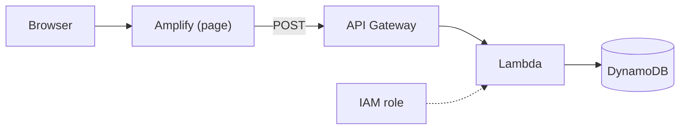

# Project Guide: To the Power of Math

A complete, beginner-friendly walkthrough. Every step says **what** to do, **where** to click and **why** it is needed. The last sections list the real mistakes I made, so you can skip them.

**Time needed:** about 1 hour. **Cost:** inside the AWS Free Tier if you clean up afterwards.

---

## 0. What we are building

A web page with two inputs (base and exponent). When you click **CALCULATE**:

1. The browser sends a `POST` request to a public URL (API Gateway).
2. API Gateway triggers a Lambda function.
3. Lambda calculates `base ^ exponent` and saves the result in DynamoDB.
4. The result travels back to the browser and appears in a pop-up.



## 1. Prerequisites

- An AWS account (set a **budget alert** first, for example at 1 USD)
- A text editor (Notepad++, VS Code...)
- Basic idea of what AWS is. You do not need to be an expert.
- Choose **one region** and use it for everything. I used **Europe (Frankfurt) `eu-central-1`**. Check the region name in the top-right corner of the console on every service.

## 2. Concepts you need (in plain words)

| Term | Meaning |
|---|---|
| **Serverless** | You upload code, AWS runs it when needed. No server to manage. |
| **Lambda** | A function that runs in response to a trigger (here: an API call). |
| **API Gateway** | Gives your Lambda a public HTTPS URL. |
| **DynamoDB** | A key-value (NoSQL) database. No schema to design up front. |
| **IAM** | The permission system. By default, nothing is allowed. |
| **Amplify** | Hosts websites. We only use it to host one HTML file. |
| **CORS** | A browser security rule. A page on domain A may only call an API on domain B if B says "A is allowed". Our page lives on `amplifyapp.com`, our API on `amazonaws.com`, so we need CORS. |

---

## Step 1: Host a simple page with Amplify

**Why:** we need a live web page first. Everything else is added step by step.

1. On your computer create a file `index.html` with the content of [`frontend/index-original.html`](frontend/index-original.html).
2. **Zip only that file** (the zip must contain `index.html` directly, not a folder).
3. In the AWS Console open **Amplify** and create a new app. Choose the option to **host without a Git provider** (drag and drop).
4. App name: `power-of-math`, environment name: `dev`.
5. Drag the zip in, then **Save and deploy**.
6. Open the link it gives you. You should see the text "To the Power of Math!".

> Tip: the page sometimes shows white while deploying. Refresh it.

## Step 2: Create the Lambda function (math only)

**Why:** this is the "brain" that calculates the result.

1. Open **Lambda → Create function → Author from scratch**.
2. Function name: `PowerOfMathFunction`, runtime: the latest **Python** available. Leave the rest as default and click **Create function**.
3. In the **Code** tab replace the code with [`lambda/lambda_function_original.py`](lambda/lambda_function_original.py).
4. Click **Deploy** (very important: saving is not enough).
5. Create a test event: **Test → Create new event**, name it, paste [`lambda/test-event.json`](lambda/test-event.json) (`base: 2`, `exponent: 3`), **Save**.
6. Click **Test**. You should see status `200` and `Your result is 8.0`.

> Numbers in the test event have **no quotes**. The code converts with `int(...)` anyway.

## Step 3: Create the API with API Gateway

**Why:** the browser cannot run a Lambda directly. It needs a public URL.

1. Open **API Gateway → Create API → REST API → Build** (a new REST API, not HTTP API).
2. Name: `PowerOfMathAPI`. Create.
3. In **Resources** click the `/` resource, then **Create method**.
4. Method type: **POST**. Integration type: **Lambda function**. Pick your function and **Save**. (Leave "Lambda proxy integration" **off**, the front-end code in this project expects the non-proxy response.)
5. **Enable CORS** (see the next box).
6. Click **Deploy API**, create a new stage called `dev`, and **Deploy**.
7. Copy the **Invoke URL**, it looks like `https://abc123.execute-api.<region>.amazonaws.com/dev`. You need it later.

### Enable CORS in the NEW console

The tutorial video uses the old console (`Actions → Enable CORS`). That menu no longer exists.

1. In **Resources**, click the **`/`** resource itself (not the POST method).
2. In the **Resource details** box on the right click **Enable CORS**.
3. Tick **POST** and **OPTIONS**. Also tick **Default 4XX** and **Default 5XX** (so errors also carry CORS headers and you see the real error in the browser).
4. **Access-Control-Allow-Origin**: `*` (fine for learning, restrict it in real life).
5. **Save**, then **Deploy API** again. CORS changes do nothing until you deploy.

Note: the message "At least one gateway response or method must be selected" simply means you must tick something before you can save.

### Test the API

In **Resources → POST → Test** use this request body:

```json
{"base": 2, "exponent": 4}
```

You should get `{"statusCode": 200, "body": "\"Your result is 16.0\""}`.

## Step 4: Create the DynamoDB table

**Why:** to store every result.

1. Open **DynamoDB → Create table**.
2. Table name: `PowerOfMathDatabase`.
3. Partition key: **`ID`**, type **String**. (Remember the exact spelling. It is case-sensitive.)
4. Leave the rest as default and **Create table**.
5. Open the table, **Additional info**, and copy the **ARN**. It looks like:
   `arn:aws:dynamodb:<region>:<account-id>:table/PowerOfMathDatabase`

## Step 5: Give Lambda permission to write to the table (IAM)

**Why:** IAM denies everything by default. Without this step you get `AccessDeniedException`.

1. **Lambda → your function → Configuration → Permissions**, click the **role name** (opens IAM).
2. **Add permissions → Create inline policy → JSON tab.**
3. Paste [`iam/dynamodb-policy.json`](iam/dynamodb-policy.json).
4. **Replace the `Resource` value with your table ARN.** Make sure there is **no space** before the closing quote.
5. **Next**, name it `PowerOfMathDynamoPolicy`, **Create policy**.

## Step 6: Update Lambda to save to DynamoDB

1. In Lambda replace the code with [`lambda/lambda_function.py`](lambda/lambda_function.py).
2. Change the table name in `dynamodb.Table('...')` to **your** table name.
3. Check that the key in `Item={'ID': ...}` matches your partition key exactly.
4. **Deploy**, then **Test**.
5. Open **DynamoDB → Explore table items → Run**. You should see a row like `ID = 8.0` and the time.

If this fails, jump to [Troubleshooting](#troubleshooting-the-real-errors-i-hit).

## Step 7: Connect the page to the API

1. Open [`frontend/index.html`](frontend/index.html).
2. Replace `YOUR_API_GATEWAY_INVOKE_URL` with the Invoke URL from Step 3.
3. Save the file as `index.html`, **zip only that file** and drag it into your Amplify app again. It redeploys automatically.
4. Open the Amplify link, enter e.g. `10` and `10`, click **CALCULATE**. A pop-up shows `Your result is 10000000000.0`.

Done! 🎉 The result is also stored in DynamoDB.

---

## Troubleshooting: the real errors I hit

| Symptom | Cause | Fix |
|---|---|---|
| Can't find **Enable CORS** under `Actions` | New console removed that menu | Click the `/` resource, use the **Enable CORS** button in *Resource details* |
| `AccessDeniedException ... no identity-based policy allows dynamodb:PutItem` and the table name in the message **has no `2`** (or wrong name) | Code points to a different table than the policy | Make the table name in the code, the policy and DynamoDB identical |
| Same `AccessDeniedException`, names are correct, policy is attached | **A trailing space inside the ARN** in the policy (`".../PowerOfMathDatabase2 "`) | Edit the policy and remove the space. Wait ~10 seconds. No need to redeploy the code |
| DynamoDB shows **no tables** | Wrong region selected in the console | Switch to the region where you created everything (top-right) |
| Item doesn't appear after test, or `ValidationException` | Key name mismatch, e.g. code uses `id` but the table key is `ID` | Use exactly the partition key name from *Table → Overview* |
| Test passes but the table is empty | You looked before running the test, or in the wrong table | Run the test again, then **Explore items → Run** |
| Changes have no effect | Forgot to press **Deploy** | Lambda: **Deploy**. API Gateway: **Deploy API** |
| `TLS_1_0` shown in API details | Default security policy | Not related to CORS. Ignore for this project |

### How to read an AWS permission error

```
User: arn:aws:sts::<account>:assumed-role/<ROLE>/<FUNCTION>
is not authorized to perform: dynamodb:PutItem
on resource: arn:aws:dynamodb:<region>:<account>:table/<TABLE>
because no identity-based policy allows the dynamodb:PutItem action
```

It tells you **who** (the role), **what** (the action) and **on which resource** (the table). Compare the resource in the message with the `Resource` in your policy, character by character.

---

## Clean-up (avoid surprise bills)

Delete everything when you are done:

1. **Amplify**: your app → **Actions → Delete app**
2. **API Gateway**: your API → **Actions / Delete**
3. **Lambda**: your function → **Actions → Delete**
4. **DynamoDB**: your table → **Delete**
5. **IAM**: delete the Lambda's execution role (name starts with your function name)
6. **CloudWatch → Log groups**: delete `/aws/lambda/<your function>`

Steps 5 and 6 are not in the original video, but they leave things behind otherwise.

## Improvements (for a more "real world" version)

- **Timestamp bug in the tutorial code:** `now = strftime(...)` was outside the handler, so it was calculated once per cold start and reused on warm invocations. In this repo it is inside the handler.
- **Same result overwrites the same row:** the partition key is the result, so `2^3` twice writes the same item. Use a unique ID (e.g. `uuid4()`) and store base and exponent as separate attributes.
- **CORS `*`:** limit to your Amplify domain.
- **Least privilege:** the Lambda only needs `dynamodb:PutItem`.
- **Protect the API:** add throttling or an API key so nobody can spam it.
- **Infrastructure as Code:** rebuild with Terraform and a CI/CD pipeline instead of clicking in the console.
- **Frontend:** show the result on the page instead of `alert()`, validate that the inputs are numbers.

## Credits

Based on the tutorial by **Tiny Technical Tutorials** on YouTube. Original HTML and Lambda code are from that tutorial. This guide, the troubleshooting notes and the improvements are my own write-up.
