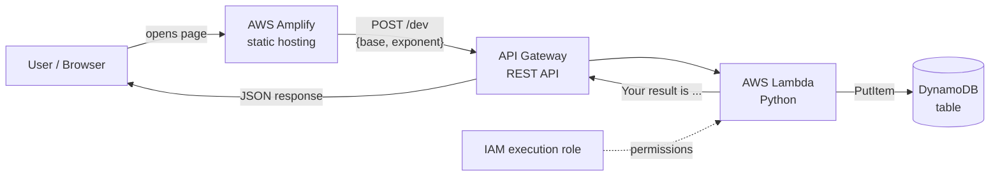

# To the Power of Math: a serverless web app on AWS

A small end-to-end web application built **by hand in the AWS Console** to learn how the core AWS services fit together. You enter a base and an exponent, the browser calls an API, a Lambda function does the math, and the result is saved to a database and shown back to you.

> This project follows a YouTube tutorial by **Tiny Technical Tutorials** (the original code comes from there). My contribution is the full written guide, the troubleshooting notes from the real errors I hit, and the clean-up and improvement notes. See [Credits](#credits).

## Architecture



| Service | Role in the project |
|---|---|
| **Amplify** | Hosts the static `index.html` page |
| **API Gateway (REST)** | Public HTTPS endpoint (`POST`) that triggers the Lambda, with CORS enabled |
| **Lambda (Python)** | Calculates `base ^ exponent` and writes the result to DynamoDB |
| **DynamoDB** | Stores each result with a timestamp |
| **IAM** | Inline policy that lets the Lambda role write to this one table |

Region used: `eu-central-1` (Frankfurt).

## Repository layout

```
power-of-math-project/
├── frontend/
│   ├── index-original.html   # Step 1: plain page, just to test Amplify hosting
│   └── index.html            # Final page: form + call to the API
├── lambda/
│   ├── lambda_function_original.py  # Step 2: math only
│   ├── lambda_function.py           # Final: math + save to DynamoDB
│   └── test-event.json              # Test event for the Lambda console
├── iam/
│   └── dynamodb-policy.json  # Inline policy template for the Lambda role
├── PROJECT_GUIDE.md          # Full step-by-step guide + mistakes I made
└── README.md
```

## Quick overview of the build

1. **Amplify:** zip `frontend/index-original.html` (named `index.html`), drag it into Amplify, get a live URL.
2. **Lambda:** create the function with `lambda_function_original.py`, test with `test-event.json`.
3. **API Gateway:** REST API, `POST` method on `/`, Lambda integration, **Enable CORS**, **Deploy API** to a `dev` stage.
4. **DynamoDB:** create a table with partition key `ID` (String).
5. **IAM:** add the inline policy from `iam/dynamodb-policy.json` to the Lambda role, with your own table ARN.
6. **Lambda (final):** paste `lambda_function.py`, set your table name, **Deploy**, test.
7. **Frontend (final):** put your API Gateway Invoke URL into `frontend/index.html`, zip it, re-upload to Amplify.

The complete walkthrough, with explanations of *why* each step exists, is in **[PROJECT_GUIDE.md](PROJECT_GUIDE.md)**.

## What I learned (the short version)

- Console UIs change: the tutorial used the old API Gateway console (`Actions → Enable CORS`), the new one has an **Enable CORS** button in the resource details.
- **Permissions errors are usually tiny typos**: a single trailing space in an ARN made IAM deny every request.
- DynamoDB key names are **case-sensitive** (`ID` is not `id`).
- Resources live in **one region**: the console shows an empty list if you look at the wrong region.
- Changes in Lambda and API Gateway only take effect after **Deploy**.

## Clean-up (to avoid charges)

Delete in this order: Amplify app, API Gateway API, Lambda function, DynamoDB table, then the Lambda's IAM role and CloudWatch log group. Details in the guide.

## Improvements I would make next

- Rebuild the whole thing with **Terraform** and a CI/CD pipeline (see my other projects)
- Restrict CORS from `*` to the Amplify domain
- Least-privilege IAM (only `dynamodb:PutItem`)
- Add API throttling / an API key

## Credits

Based on the *"Build an end-to-end AWS web application"* tutorial by **Tiny Technical Tutorials** on YouTube. The sample code (HTML, Lambda) is from that tutorial; the documentation, troubleshooting notes and extras are my own.
